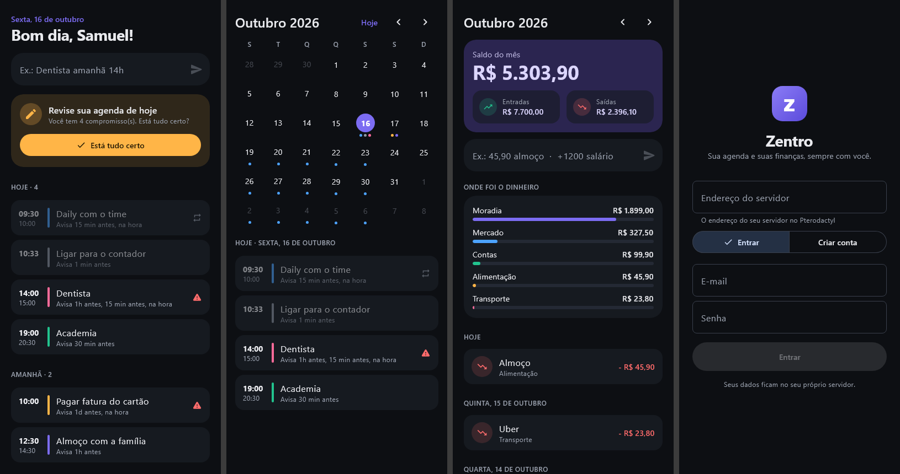
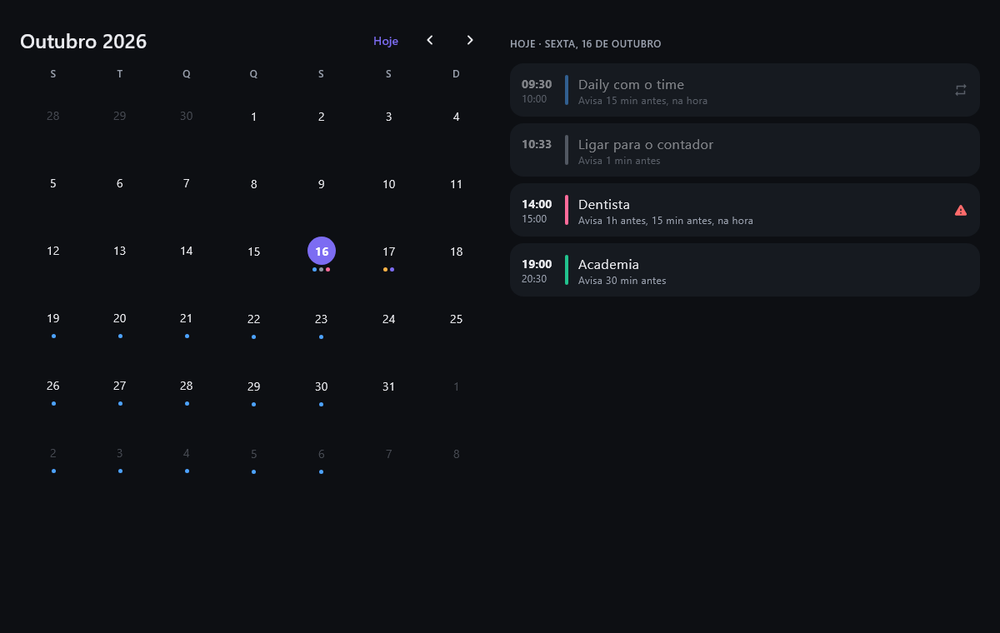
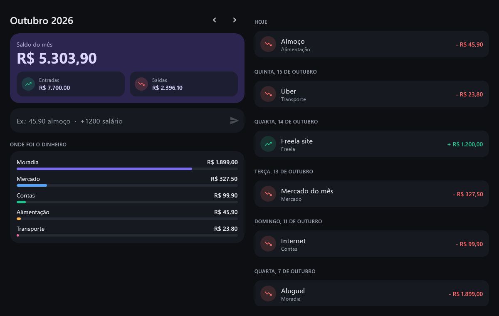
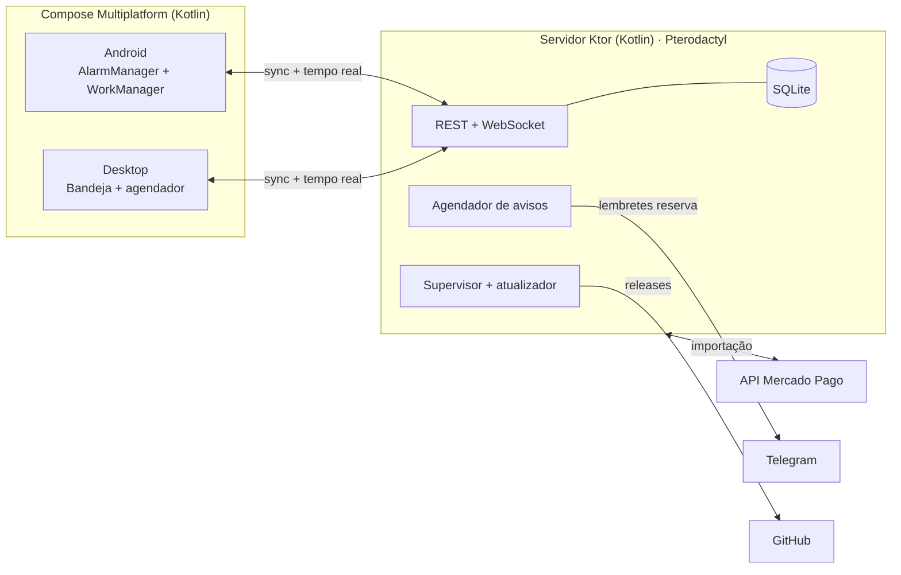

<div align="center">


# Zentro

**Agenda, anotações e finanças pessoais que não deixam você esquecer de nada.**
Android + Desktop (Windows, Linux, macOS) sincronizados em tempo real, com servidor próprio pronto para o Pterodactyl.


</div>



| Agenda no desktop | Finanças no desktop |
|---|---|
|  |  |

## O que ele faz

- **Agenda simples e rápida.** Escreva `Dentista amanhã 14h` e pronto: o compromisso é criado com avisos. Também entende `reunião sexta 9:30`, `pagar luz 10/11`, `depois de amanhã`…
- **Avisos que não falham.** Várias camadas independentes (veja abaixo). Compromissos **críticos** tocam como despertador, em tela cheia, até você confirmar.
- **Cobra a atualização da agenda.** Nos horários que você escolher (padrão 09:00 e 20:00), se você ainda não mexeu na agenda naquele dia, o Zentro te lembra.
- **Agenda de quem você acompanha.** Marque os compromissos da namorada, do filho ou do sócio junto com os seus: aparecem com o nome da pessoa, têm filtro próprio e também te avisam. Escreva `Ana: prova sexta 10h` e pronto.
- **Anotações estilo Notion/Obsidian.** Pastas (Trabalho, Faculdade, Projetos...), Markdown, `[[links]]` entre notas com sugestão enquanto digita, "mencionada em", `#tags`, checklists, modelos prontos, nota do dia, todas as tarefas abertas num lugar e mapa de conexões.
- **Claude e ChatGPT conhecem suas notas.** Conecte uma vez e peça em qualquer conversa: "faça o que está na nota Bed Wars". A IA lê a nota, incluindo tabelas e imagens, e faz o que você descreveu.
- **Atualiza sozinho.** Servidor, PC e celular buscam as versões novas no GitHub. Ao abrir, o app já baixa e instala. Com ele aberto, aparece um aviso.
- **Contas a pagar.** `Hospedagem todo dia 5 49,90` cria uma conta mensal que avisa antes de vencer. Ao tocar em **Pagar**, a saída entra nas finanças e os avisos daquele mês param. Contas atrasadas ficam no topo da tela Hoje.
- **Finanças sem esforço.** `45,90 almoço` registra uma saída e `+1200 freela` uma entrada, com a categoria sugerida automaticamente. Saldo do mês, entradas, saídas e para onde foi o dinheiro.
- **Mercado Pago.** Importa automaticamente os pagamentos recebidos e feitos na sua conta.
- **Celular e computador conectados.** Mudou num, aparece no outro em segundos (WebSocket). Funciona offline e sincroniza quando a internet volta.
- **Seus dados no seu servidor.** Um `.jar` só, banco SQLite em arquivo, egg pronto para o Pterodactyl.

## Por que os avisos não falham

| Camada | Como funciona |
|---|---|
| **Alarme do sistema (Android)** | Os lembretes usam `AlarmManager.setAlarmClock`, o mesmo mecanismo do app Relógio, o único que o Android garante disparar no minuto exato mesmo em soneca (Doze) e economia de bateria. Os próximos 7 dias ficam agendados no aparelho. |
| **Funciona offline** | A agenda fica salva no aparelho. Sem internet, os alarmes continuam tocando. |
| **Reagendamento automático** | Os alarmes são refeitos quando a agenda muda, quando um alarme toca, a cada 15 min (WorkManager), todo dia às 04:00, ao ligar o celular, ao atualizar o app e ao mudar o relógio ou o fuso. |
| **Avisos perdidos** | Se o celular estava desligado, ao ligar ele mostra o que você perdeu nas últimas 6 horas. O desktop faz o mesmo ao abrir. |
| **Críticos** | Tela cheia por cima do bloqueio, som de alarme repetindo (`FLAG_INSISTENT`) e botões "Estou ciente" e "Adiar 5 min". No PC, uma janela fixa por cima de tudo com som em loop. |
| **Desktop sempre ativo** | Inicia junto com o sistema, fica na bandeja e mostra aviso flutuante e notificação do sistema. Fechar a janela não desliga os avisos. |
| **Telegram (reserva no servidor)** | Mesmo com o celular sem bateria ou o PC desligado, o servidor manda o lembrete pelo Telegram, que chega no celular, no relógio e no PC. |
| **Checklist no app** | Em Ajustes › *Avisos garantidos*, o app verifica permissões (notificação, alarme exato, bateria, tela cheia) e tem um botão para corrigir cada uma, além de *Testar aviso*. |

## Anotações

| Escreva | Vira |
|---|---|
| `# Título`, `## Seção` | Títulos |
| `- [ ] tarefa` | Checklist clicável (aparece também em *Notas › Tarefas*) |
| `[[Outra nota]]` ou `[[Outra nota\|apelido]]` | Link. Se a nota não existir, é criada ao clicar |
| `#faculdade` | Tag, com filtro na barra lateral |
| `**negrito**`, `*itálico*`, `` `código` ``, `> citação`, `---` | Formatação |
| `\| A \| B \|` + `\|---\|---\|` | Tabela (o formato que o Claude e o ChatGPT usam) |
| `` numa linha | Imagem. No editor, use o botão 🖼 ou cole um print com Ctrl+V |

- **Pastas e subpastas:** `Faculdade/Cálculo`.
- **Modelos:** Reunião, Aula, Projeto, Ideia e Nota do dia (diário).
- **Mencionada em:** cada nota mostra quais outras apontam para ela.
- **Mapa:** visualize como as notas se conectam e toque para abrir.
- **Busca:** procura em título, conteúdo e tags, com trecho destacado.

## Claude e ChatGPT (MCP)

O servidor expõe suas notas, **somente leitura**, pelo [Model Context Protocol](https://modelcontextprotocol.io), o padrão usado pelo Claude e pelo ChatGPT para acessar ferramentas externas. Ferramentas disponíveis:

| Ferramenta | O que faz |
|---|---|
| `search` | Busca notas por título, conteúdo ou `#tag` |
| `fetch` | Lê a nota completa (Markdown, tabelas e imagens) |
| `list_notes` | Lista as notas, opcionalmente de uma pasta |

**Como conectar:** no app, abra *Ajustes › Claude e ChatGPT › Conectar*.

- **Claude Code:** copie o comando mostrado e rode uma vez no terminal. Ele fica disponível em todos os projetos:
  ```bash
  claude mcp add --scope user --transport http zentro http://SEU_SERVIDOR/mcp --header "Authorization: Bearer SUA_CHAVE"
  ```
- **ChatGPT:** em *Configurações › Aplicativos e conectores › Criar*, cole o endereço mostrado (`https://SEU_SERVIDOR/mcp/SUA_CHAVE`). O ChatGPT só aceita endereços **https**. Se o seu servidor é `http://IP:porta`, coloque um HTTPS na frente, por exemplo com um [Cloudflare Tunnel](https://developers.cloudflare.com/cloudflare-one/connections/connect-networks/) apontando para `http://IP:porta`.

Depois, em qualquer conversa: *"faça o que está na nota Bed Wars no projeto"*. Para cortar o acesso, use **Gerar chave nova**.

## Atualização automática

| Onde | Como funciona |
|---|---|
| **Servidor** | O próprio `.jar` supervisiona o servidor. A cada 6 horas confere o GitHub; achando versão nova, baixa, confere se o arquivo está íntegro, troca e reinicia em segundos. Se a versão nova falhar ao subir, volta para a anterior. Se o servidor cair por qualquer motivo, ele é reiniciado sozinho. |
| **PC (Windows)** | Ao abrir, se houver versão nova, baixa o instalador, fecha, instala em silêncio e reabre. Com o app aberto, mostra um aviso com o botão **Atualizar**. |
| **Android** | Ao abrir, baixa o APK novo e abre a tela de instalação. O Android sempre pede um toque para confirmar e, na primeira vez, para permitir "instalar desta fonte". |

Para o APK atualizar por cima da versão anterior, as releases precisam ser assinadas sempre com a mesma chave. Configure uma vez os segredos do repositório: `ZENTRO_KEYSTORE_B64`, `ZENTRO_KEYSTORE_PASSWORD`, `ZENTRO_KEY_ALIAS` e `ZENTRO_KEY_PASSWORD`.

> **Vindo da 1.0.0?** O APK da 1.0.0 foi assinado com outra chave. Desinstale-o uma vez e instale a 1.1.0; seus dados voltam do servidor ao entrar. No servidor, clique em **Reinstall** uma vez para receber o supervisor; daí em diante ele se atualiza sozinho.

## Arquitetura



```
zentro/
├── shared/       # Kotlin Multiplatform: modelos, API, recorrência e avisos, entrada rápida, Markdown e links das notas
├── server/       # Ktor + Exposed + SQLite: API, sincronização, Telegram, Mercado Pago, supervisor e auto-update
├── composeApp/   # App Compose Multiplatform
│   ├── commonMain/   # Telas (agenda, notas, finanças), repositório local-first, fila offline, atualizações
│   ├── androidMain/  # Alarmes, notificações, tela cheia, boot, WorkManager
│   └── desktopMain/  # Bandeja, avisos flutuantes, alarme crítico, autostart
├── pterodactyl/  # Egg pronto para importar
└── .github/      # CI e releases automáticas
```

**Destaques técnicos**

- **Um motor de agenda só** (`shared/Schedule.kt`) calcula recorrências e horários dos avisos para servidor, Android e desktop, com testes unitários.
- **Local-first com fila persistente.** Cada alteração é aplicada no aparelho na hora e vai para uma fila (`outbox`) que é reenviada até o servidor aceitar. Os IDs são UUIDs gerados no cliente, então reenviar nunca duplica.
- **Sincronização incremental** por `updatedAt` com *tombstones* (itens apagados também sincronizam) e aviso em tempo real via WebSocket.
- **Isolamento por usuário** com chave composta `(user_id, id)`, autenticação JWT e senhas com BCrypt.

## Instalação do servidor (Pterodactyl)

1. **Publique uma release.** Crie uma tag no GitHub (`git tag v1.0.0 && git push origin v1.0.0`). O GitHub Actions gera o `zentro-server.jar`, o APK e os instaladores do desktop.
2. **Importe o egg.** No painel: *Admin › Nests › Import Egg* e envie [`pterodactyl/egg-zentro.json`](pterodactyl/egg-zentro.json).
3. **Crie o servidor** com o egg *Zentro Server* (imagem Java 21). 256 MB de RAM são suficientes. Confira a variável **Repositório no GitHub** (`usuario/zentro`).
4. **Inicie.** Quando aparecer `Zentro server started` no console, está no ar. Abra `http://IP:PORTA` no navegador para conferir.
5. **Crie sua conta** pelo app e depois mude **Permitir novos cadastros** para `false`.

> Com `ZENTRO_AUTO_UPDATE=true` o servidor se atualiza sozinho. Para forçar uma versão específica, mude *Versão* e clique em **Reinstall**. Os dados em `data/` são sempre preservados.
> Console do servidor: `status` mostra a versão e `stop` desliga com segurança.

### Variáveis

| Variável | Padrão | Descrição |
|---|---|---|
| `GITHUB_REPO` | `zyypj/zentro` | Repositório de onde baixar a release |
| `VERSION` | `latest` | Tag da release a instalar |
| `DOWNLOAD_URL` | vazio | Link direto para o `.jar` (opcional) |
| `ZENTRO_AUTO_UPDATE` | `true` | Atualiza o servidor sozinho pelas releases do GitHub |
| `ZENTRO_ALLOW_REGISTRATION` | `true` | Permite criar novas contas |
| `TELEGRAM_BOT_TOKEN` | vazio | Ativa os avisos reserva pelo Telegram |
| `ZENTRO_DATA_DIR` | `data` | Pasta do banco e da chave de sessão |

Sem Pterodactyl? `docker build -t zentro . && docker run -p 8080:8080 -v zentro-data:/app/data zentro`

## Backups

O servidor salva uma cópia do banco em `data/backups` ao iniciar, todo dia às 03:30 e antes de cada atualização, e mantém as 20 mais recentes. Para criar uma na hora, digite `backup` no console.

**Para restaurar:** pare o servidor e copie o backup desejado por cima de `data/zentro.db`. Apague `zentro.db-wal` e `zentro.db-shm`, se existirem, e inicie de novo.

O app também guarda uma cópia local. Se você entrar numa conta vazia (por exemplo, depois de recriar o servidor), ele oferece recuperar os dados do aparelho. Em *Ajustes › Conta* há **Enviar meus dados de novo**.

> **Atenção no Pterodactyl:** **Reinstall** preserva a pasta `data`. Já **apagar e recriar o servidor** apaga tudo, inclusive os backups. Antes disso, baixe a pasta `data` pelo gerenciador de arquivos.

## Telegram (recomendado)

1. No Telegram, fale com o [@BotFather](https://t.me/BotFather), envie `/newbot` e copie o token.
2. Cole o token na variável `TELEGRAM_BOT_TOKEN` do servidor e reinicie.
3. No app: *Ajustes › Conectar Telegram* abre o bot. Toque em **Iniciar** e pronto.
4. Comandos do bot: `/hoje` e `/amanha` mostram sua agenda.

## Mercado Pago

1. Acesse [mercadopago.com.br/developers/panel](https://www.mercadopago.com.br/developers/panel) e crie uma aplicação.
2. Em *Credenciais de produção*, copie o **Access Token** (`APP_USR-...`).
3. No app: *Ajustes › Mercado Pago*, cole o token e toque em **Conectar**.

A primeira importação traz os últimos 90 dias e depois atualiza sozinha a cada 15 minutos. Para importar na hora, cadastre a URL de webhook mostrada no app em *Webhooks › Pagamentos* no painel do Mercado Pago.

> **Limitação importante:** a API pública do Mercado Pago é voltada para vendedores. O Zentro importa os **pagamentos aprovados** em que você recebe (entradas, pelo valor líquido) e, quando a API permite, os que você paga (saídas). Algumas movimentações, como Pix enviados do saldo, transferências e rendimentos, podem não aparecer na API. Para essas, use o lançamento rápido (`45,90 almoço`).

## Instalando os apps

- **Android:** baixe o `Zentro.apk` da release e instale. Abra *Ajustes › Avisos garantidos* e deixe tudo verde.
- **Windows:** baixe o `.msi` (ou `.exe`). O app inicia com o Windows e fica na bandeja.
- **Linux / macOS:** `.deb` e `.dmg` na release.

No primeiro acesso, informe o endereço do servidor (ex.: `123.45.67.89:8080`), seu e-mail e senha.

## Desenvolvimento

Requer JDK 21. O Android SDK é opcional: sem ele, o build ignora o alvo Android automaticamente.

```bash
./gradlew :shared:jvmTest :server:test   # testes
./gradlew :server:run                     # servidor em http://localhost:8080
./gradlew :composeApp:run                 # app desktop
./gradlew :composeApp:assembleDebug       # APK (precisa do Android SDK)
./gradlew :composeApp:packageMsi          # instalador Windows
```

Commits seguem [Conventional Commits](https://www.conventionalcommits.org/pt-br/).

## Licença

[MIT](LICENSE)
